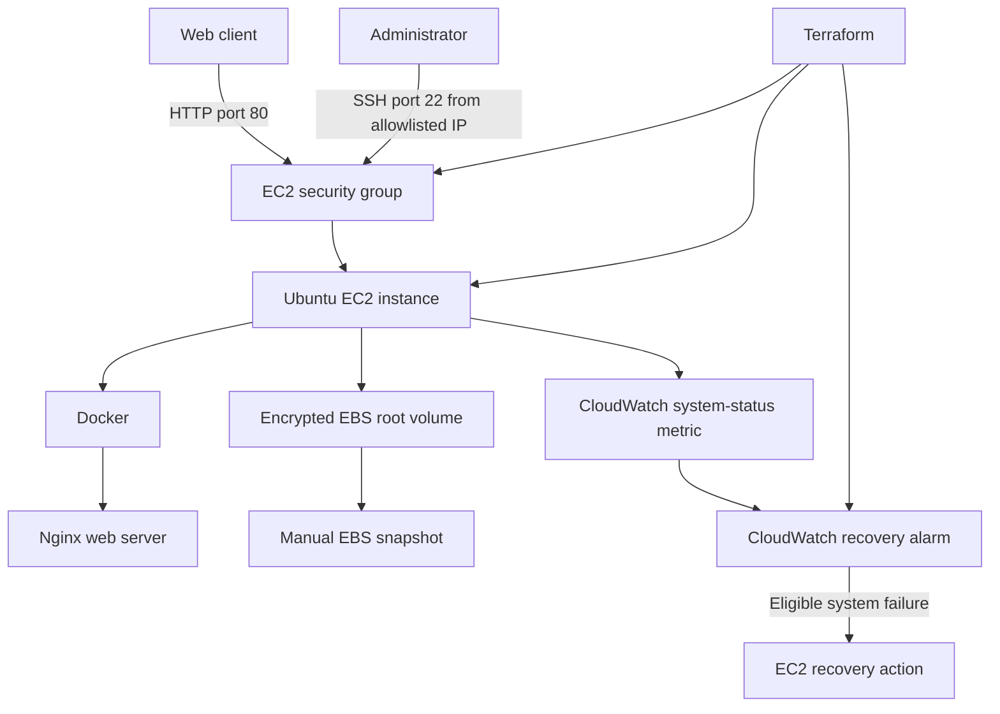

# EC2 Production Recovery Lab

A hands-on AWS infrastructure recovery project built with Terraform, Amazon EC2, Amazon EBS, Amazon CloudWatch, Docker, and Nginx.

## Project goals

- Provision infrastructure using Terraform.
- Serve a test web application on an EC2 instance.
- Restrict SSH access to an administrator-defined IPv4 address.
- Monitor EC2 system status with a CloudWatch alarm.
- Configure the supported EC2 automatic recovery action.
- Create and verify an encrypted EBS snapshot.
- Test application failure and manual recovery.
- Document recovery procedures, limitations, and cleanup.

## Architecture



## Technology stack

- AWS EC2 — compute
- Amazon EBS — persistent block storage
- Amazon EBS snapshots — point-in-time volume backup
- Amazon CloudWatch — EC2 system-status monitoring and alarm
- Terraform — infrastructure as code
- Docker — application container runtime
- Nginx — sample HTTP application
- Ubuntu Server 24.04 LTS — operating system

## Repository layout

```text
ec2-production-recovery/
├── README.md
├── .gitignore
├── terraform/
│   ├── versions.tf
│   ├── variables.tf
│   ├── main.tf
│   ├── outputs.tf
│   ├── user_data.sh
│   └── terraform.tfvars.example
├── docs/
│   ├── architecture.md
│   ├── recovery-procedure.md
│   └── rca-template.md
└── scripts/
    └── verify.ps1
```

## Deployment

Prerequisites:

- AWS CLI configured with an identity authorized to create EC2, security groups, CloudWatch alarms, and EBS snapshots.
- Terraform 1.6 or newer.
- An existing EC2 key pair in the selected AWS region.
- Git.
- Windows PowerShell for the commands below.

From the repository root:

1. Copy the example variables file and edit the administrator IP address.

   ```powershell
   Copy-Item terraform/terraform.tfvars.example terraform/terraform.tfvars
   notepad terraform/terraform.tfvars
   ```

2. Initialize Terraform.

   ```powershell
   cd terraform
   terraform init
   terraform fmt -recursive
   terraform validate
   ```

3. Review the proposed changes before deploying.

   ```powershell
   terraform plan -out="recovery.tfplan"
   ```

4. Apply only after reviewing the plan.

   ```powershell
   terraform apply "recovery.tfplan"
   ```

5. Read the outputs.

   ```powershell
   terraform output
   ```

The actual deployment in this lab completed successfully with three Terraform-managed resources created. Do not commit state files or saved plans.

## Validation and test evidence

The following checks were performed in the lab:

| Test | Result |
|---|---|
| Terraform deployment | Passed |
| External HTTP request to Nginx | HTTP 200 OK |
| Stop Nginx container | External HTTP request failed as expected |
| Restart Nginx container | Container returned to running state |
| Local HTTP request after restart | HTTP 200 OK |
| External HTTP request after restart | HTTP 200 OK |
| CloudWatch recovery alarm | State `OK`; EC2 recovery action configured |
| Encrypted EBS snapshot | Snapshot reached `completed` state |

The application outage test was recovered by manually restarting the Docker container. It did not test an EC2 host/system failure or prove that the CloudWatch EC2 recovery action had executed.

## Recovery objectives and limitations

For a real service, recovery time objective (RTO) and recovery point objective (RPO) must be defined, approved, and measured. This lab does not establish guaranteed RTO or RPO values.

- The EBS snapshot created during this exercise is a one-time backup.
- No scheduled backup policy or automated snapshot retention is configured.
- EC2 automatic recovery applies only to supported underlying system failures and is not a general application-health restart mechanism.
- A single EC2 instance is a single point of failure.
- The application is plain HTTP and is not configured with TLS, a load balancer, or a custom domain.
- Recovery has not been validated across Availability Zones.

For stronger production resilience, consider a multi-AZ architecture with an Application Load Balancer and Auto Scaling Group, automated backups and retention, centralized logs, application-level health checks, TLS, and tested restoration procedures.

## Security notes

- SSH access is limited to the CIDR specified by `ssh_cidr`.
- HTTP is publicly reachable in this lab.
- Use least-privilege AWS IAM permissions.
- Never commit private keys, credentials, Terraform state, saved plans, or the local `terraform.tfvars` file.
- The example variables file is safe to commit because it contains placeholders only.

## Cost and cleanup

AWS resources can incur charges, including EC2 runtime, EBS storage, snapshots, public IPv4 addresses, and monitoring. Review current AWS pricing for your region.

When you no longer need the lab, review the resources and the Terraform destroy plan:

```powershell
cd terraform
terraform plan -destroy
```

If the plan contains only resources you intend to remove, execute:

```powershell
terraform destroy
```

The root EBS volume is configured with `delete_on_termination = false`, so check whether it remains after destroying the instance. Delete leftover volumes or snapshots only if you are certain they are no longer needed. Keep the snapshot if you want to preserve the backup.

## Learning outcomes

This project demonstrates infrastructure as code, cloud monitoring, storage backups, container operations, basic failure testing, recovery documentation, and secure repository hygiene.

